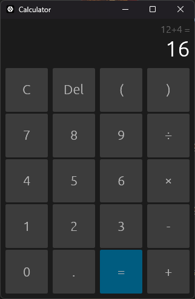

# rust-calculator

A simple desktop calculator written in Rust, using [egui](https://github.com/emilk/egui).



- `+ - × ÷`, parentheses and negative numbers, with normal operator precedence (`2+3×4` is 14)
- Mouse or keyboard: digits, `+ - * / ( ) .`, Enter for `=`, Backspace to delete, Esc to clear
- The result carries into the next calculation; typing a digit after `=` starts a new one
- Single `.exe` on Windows: no installer, no console window, no Visual C++ runtime needed

## Download (Windows)

Grab `rust-calculator.exe` from the [latest release](https://github.com/DerpyNewb/rust-calculator/releases/latest) and run it.

## Build from source

You need [Rust](https://rustup.rs). On Windows you also need the MSVC build tools and a
Windows 10/11 SDK (Visual Studio "Desktop development with C++" covers both).

```
cargo run --release      # build and launch
cargo test               # parser and formatting tests
```

The release binary lands at `target/release/rust-calculator.exe` (or `rust-calculator`
on Linux and macOS).

## License

MIT
